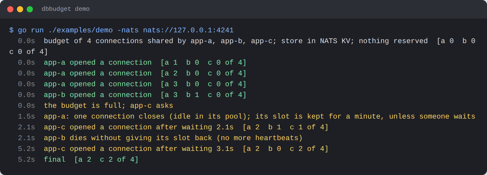
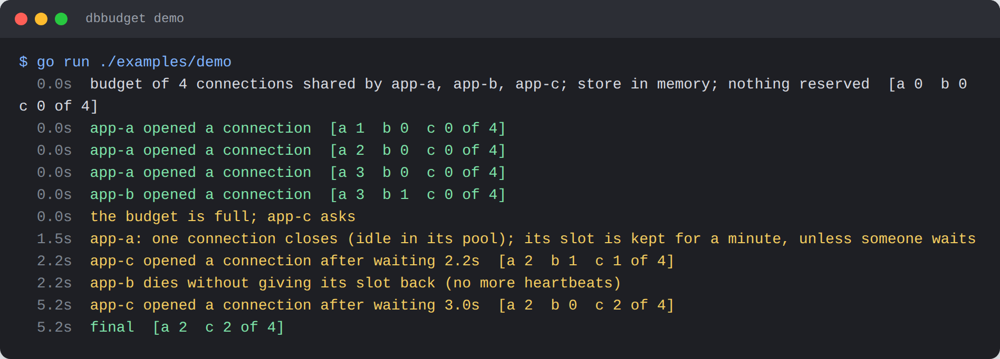

# dbbudget

**Keep the database connections of many app instances under one limit, without reserving anything in advance.**

PostgreSQL allows a fixed number of connections. Ten instances with a pool of 20 each ask for 200. The usual fixes
are a pooler (PgBouncer, RDS Proxy, Cloud SQL managed pooling) or small fixed pools that waste what idle instances
hold. dbbudget shares one budget instead:

- **Nothing is reserved.** An instance takes a slot when it opens a connection.
- **Idle gives way.** It keeps a slot for a short idle grace after the connection closes. When the budget is full
  and another instance waits, an instance with an idle connection closes it and hands the slot over.
- **Dead instances return their share by themselves.** Slots carry a TTL renewed by a heartbeat.
- **Store down, one connection.** When the shared store cannot be reached, an instance keeps at most one connection
  open until it can again.
- **Physical connections are counted**, in the dialer, so it works with pgxpool, pgx, `database/sql` and any driver
  that takes a dial function.
- One interface, stores for every platform, each in its own package: **NATS KV**, **Redis/Valkey**, **DynamoDB**,
  **Firestore**, in memory; and **Fixed** when a real pooler is in front.



## Contents

- [Rules and traps for the next developer: AGENTS.md](AGENTS.md)
- [Install](#install)
- [Quick start](#quick-start)
- [How it works](#how-it-works)
- [How to](#how-to)
  - [pgxpool](#pgxpool)
  - [database/sql (and GORM)](#databasesql-and-gorm)
  - [Behind a real pooler: Fixed](#behind-a-real-pooler-fixed)
  - [Pick Max](#pick-max)
  - [Test it](#test-it)
  - [Write a store](#write-a-store)
- [Run it on: local / AWS / Google](#run-it-on-local--aws--google)
- [Options](#options)
- [Run the demo](#run-the-demo)
- [Development](#development)

## Install

Go 1.26 or later:

```sh
go get github.com/ez-technologies/dbbudget@latest
```

| Package | What | SDK it pulls in |
|---|---|---|
| `dbbudget` | `Budget`, `New` (shared), `Fixed`, `Dial`, `NewMemoryStore`, `SQLPressure` | none |
| `dbbudget/natskv` | store on a NATS JetStream key-value bucket (watches wants: hand-over at once) | `nats.go` |
| `dbbudget/redisstore` | store on Redis or Valkey | `go-redis/v9` |
| `dbbudget/dynamostore` | store on AWS DynamoDB | `aws-sdk-go-v2/service/dynamodb` |
| `dbbudget/firestorestore` | store on Google Cloud Firestore | `cloud.google.com/go/firestore` |
| `dbbudget/pgxbudget` | pgx and pgxpool wiring | `pgx/v5` |
| `dbbudget/budgettest` | the store conformance suite | none |

## Quick start

```go
store, _ := natskv.New(ctx, js, "db_budget")
budget, err := dbbudget.New(store, dbbudget.Options{
	Max:    80,                                         // all instances together
	Holder: hostname + "-" + strconv.Itoa(os.Getpid()), // unique per instance
})
defer budget.Close(context.Background()) // gives every slot back

pool, err := pgxbudget.NewPool(ctx, os.Getenv("DATABASE_URL"), budget, 20, 30*time.Second)
budget.SetOnPressure(func() { pgxbudget.Pressure(pool) }) // close idle connections for a waiting instance
```

Use the pool as usual. A query that needs a new connection waits (up to its context) while the budget is full.

## How it works

The budget is a table of `Max` slots in the store. One slot is one open connection.

1. Opening a connection takes a permit: a free slot of this instance, or a new slot from the store.
2. When the store has none free, the instance records that it **wants** one and waits, retrying every `Poll`.
3. Every instance checks for wants every second (at once with NATS KV, which watches). An instance with a free
   slot gives it back at once; one whose connections are all open but idle in its pool gets `OnPressure`, closes
   idle connections, and their slots go.
4. A closed connection's slot is kept for `IdleGrace` (30 s) for the next connection, then given back, except the
   last `MinHold` (1), which stays unless someone waits.
5. When this process itself has to wait while its pool holds idle connections (a pool allowed more connections than
   the budget gives), `OnPressure` is called too, so it does not wait on its own idle connections. `Fixed` does the
   same (`SetOnPressure`).
6. A heartbeat renews every slot each `TTL/3`. A slot that expired and was taken by someone else is dropped
   (logged). When the store fails, the instance is degraded: at most one connection until a heartbeat succeeds.

Trade-offs: a waiting instance waits about a second (a poll) for a hand-over unless the store watches; expiry times
in NATS KV, DynamoDB and Firestore are written by the instances' clocks, so keep clocks in sync and the TTL well
above the skew (Redis uses its own key TTLs). Connections already open when the store goes down stay open; only new
ones are held to one.

## How to

### pgxpool

```go
cfg, _ := pgxpool.ParseConfig(url)
pgxbudget.Configure(cfg.ConnConfig, budget) // every dial waits for a permit
cfg.MaxConns = 20                           // a ceiling; the budget decides
cfg.MaxConnIdleTime = 30 * time.Second      // idle connections close, so their slots can go
pool, _ := pgxpool.NewWithConfig(ctx, cfg)
budget.SetOnPressure(func() { pgxbudget.Pressure(pool) })
```

`pgxbudget.NewPool` does exactly this.

### database/sql (and GORM)

```go
cc, _ := pgx.ParseConfig(url)
pgxbudget.Configure(cc, budget)
db := stdlib.OpenDB(*cc)
db.SetMaxOpenConns(20)
db.SetMaxIdleConns(4)
db.SetConnMaxIdleTime(30 * time.Second)
budget.SetOnPressure(func() { dbbudget.SQLPressure(db, 4) })

gdb, _ := gorm.Open(postgres.New(postgres.Config{Conn: db}), &gorm.Config{})
```

Any other driver: wrap its dial function with `dbbudget.Dial(budget, next)`.

### Behind a real pooler: Fixed

With PgBouncer, RDS Proxy or Cloud SQL managed pooling, the pooler bounds the database. Keep each instance's own
count with the same interface:

```go
budget := dbbudget.Fixed(10)
```

### Pick Max

`max_connections` minus what admin tools, migrations, backups and replication need (say 10). If instances also run
queries outside the budgeted pool (a migration tool, a second pool), leave room for those.

### Test it

`dbbudget.NewMemoryStore()` shares a budget between budgets in one process; `Fail(err)` simulates the store going
down.

### Write a store

Implement `dbbudget.Store` (and optionally `dbbudget.Watcher`) and run the suite with a fresh namespace each time:

```go
func TestStore(t *testing.T) {
	budgettest.Store(t, func(t *testing.T) dbbudget.Store { return mystore.New(uniqueName()) })
}
```

## Run it on: local / AWS / Google

| | Local or any host | AWS | Google Cloud |
|---|---|---|---|
| Store | `natskv` or `redisstore` | `dynamostore` or `redisstore` (ElastiCache) | `firestorestore` or `redisstore` (Memorystore) |
| With a pooler | `Fixed` (PgBouncer) | `Fixed` (RDS Proxy) | `Fixed` (Cloud SQL managed pooling) |

**NATS KV**: `natskv.New(ctx, js, "db_budget")` makes the bucket (history 1). With NATS accounts the instances need
publish and subscribe on `$KV.db_budget.>` and `$JS.API.>` (or the bucket's stream API subjects).

**Redis / Valkey** (ElastiCache, Memorystore, your own): `redisstore.New(redis.NewClient(&redis.Options{Addr: addr}), "db_budget")`.
Keys `db_budget:slot:<n>` (with TTL) and the sorted set `db_budget:wants`. With Redis ACLs:
`+set +get +pexpire +del +zadd +zrem +zcard +zscore +zremrangebyscore +evalsha +eval ~db_budget:*`.

**DynamoDB**: a table with string partition key `pk` and string sort key `sk` (`dynamostore.New(c, "dbbudget", "prod").CreateTable(ctx)`
makes it, on demand, TTL on `ttl`). IAM on `arn:aws:dynamodb:<region>:<account>:table/dbbudget`:
`dynamodb:PutItem`, `dynamodb:DeleteItem`, `dynamodb:Query`; for `CreateTable` also `dynamodb:CreateTable`,
`dynamodb:UpdateTimeToLive`. Credentials from the default chain (instance or task role).

**Firestore**: `firestorestore.New(client, "dbbudget", "prod")`; documents `<name>-slot-<n>` and `<name>-want-<holder>`.
Role `roles/datastore.user` (`datastore.entities.get`, `.create`, `.update`, `.delete`, `.list`). The want query uses
two equality filters, which need no composite index. A TTL policy on `ttl` is optional cleanup.

All four stores pass the same suite, on nats-server 2.15, Valkey 8.1, DynamoDB Local 2.6 and the Firestore emulator.
`dynamostore` and `firestorestore` have not yet run against the real services: treat them as **experimental**
until they have.

## Options

`dbbudget.Options`:

| Option | Default | Meaning |
|---|---|---|
| `Max` | required | connections across all instances |
| `Holder` | required | this instance's unique name |
| `TTL` | 15s | slot lifetime; renewed every TTL/3; a dead instance's slots return after it |
| `IdleGrace` | 30s | a slot whose connection closed is kept this long |
| `MinHold` | 1 | slots kept when idle (not when another instance waits) |
| `Poll` | 250ms | how often a waiting Acquire retries |
| `OnPressure` | none | close idle connections when others wait, or this process waits (`pgxbudget.Pressure`, `dbbudget.SQLPressure`); also `SetOnPressure` (on `Fixed` too) |
| `Logger` | `slog.Default()` | store failures and lost slots |

`Shared` also answers `Share()` (connections it may open now), `InUse()` and `Degraded()`.

## Run the demo

```sh
go run ./examples/demo                              # the store in memory
docker run -d --name nats -p 4222:4222 nats:2.15.2-alpine -js
go run ./examples/demo -nats nats://127.0.0.1:4222
```



## Development

```sh
eval "$(scripts/test-env.sh up)"   # nats-server, Valkey, DynamoDB Local, the Firestore emulator, PostgreSQL
gofmt -l . && go vet ./... && go test -race ./...
scripts/test-env.sh down
```

Without those variables the store tests are skipped (the root tests always run). The tests never reach a cloud
account. Screenshots: `NODE_PATH=<node_modules with playwright> node scripts/screenshots.mjs nats://127.0.0.1:4241`.

## License

MIT
